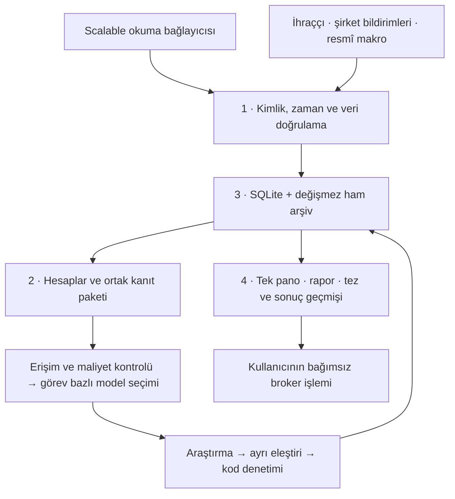

# Birleşik Yatırım Araştırma Masası — Nihai Sistem Tasarımı

**Tarih:** 30 Ekim 2026 · **Sürüm:** 2 — Claude incelemesiyle birleştirilmiş son plan · **Kapsam:** Mac üzerinde kişisel araştırma, portföy kaydı ve karar desteği · **Durum:** Uygulama öncesi tasarım

**Ana karar:** Mevcut ETF masasını koruyan, Scalable verisini tarihli kayıtlarda birleştiren, hesapları kodla yapan, görev için uygun modeli doğrulanmış erişim havuzundan seçen **tek yerel Python uygulaması** kurulmalı. Başlangıçta SQLite, değişmez ham dosyalar ve statik HTML yeterlidir. TradingAgents çekirdeğin sahibi değil, kanıt ve maliyet denetiminden geçen isteğe bağlı araştırma motorudur.

**Son revizyonda kesinleşenler:** Yeni uygulama `ETF/masa/` altında ayrı proje ve ortamda geliştirilecek; bağımlılık yönetimi `uv` ile yapılacak. ISIN kontrol hanesi ve kaynağı bilinen işlem yeri takvimi denetlenecek. Model seçimi sürümlü bir doğrulama kümesiyle yönetilecek. Denetim izi için ekleme esaslı kayıt ve hash zinciri, muhasebe için isteğe bağlı Portfolio Performance karşılaştırması kullanılacak. Vergi gölge defteri çekirdekten bağımsız, varsayılan kapalı bir sonraki aşama seçeneğidir. WAL modu ve dosyadaki paket sürümleri otomatik devralınmayacak.

## İncelemenin kapsamı ve kanıt sınırı

Kullanıcının ilk yapıştırılmış metnindeki beş aşamalı sentez talebi ile dinamik model seçimi ve kurulum listesi isteği esas alındı. Diğer metinlerdeki geçmiş rol atamaları, delegasyon anlatıları, “kuruldu”, “doğrulandı” ve “dosyalara dokunulmadı” ifadeleri bu çalışmada verilmiş talimat veya doğrulama sayılmadı.

Üç yapıştırılmış metin, masaüstündeki sistem tasarımı ve son olarak [Claude tasarımı](~/Desktop/claude.md) karşılaştırıldı. İlk sürümdeki yerel doğrulama kaydı şöyledir; aşağıdaki test sonucu bu revizyonda yeniden çalıştırılmış bir test olarak sunulmamaktadır:

- Scalable CLI `1.0.0` ve TradingAgents `0.7.1` yerel olarak doğrulandı.
- Mevcut test paketi yeniden çalıştırıldı: **34 test, tamamı başarılı**. Testler geçici çalışma klasörleri kullanır; canlı broker bağlantısını veya yatırım araştırmasının doğruluğunu sınamaz.
- TradingAgents portföy sözleşmesi sentetik veriyle sınandı: raporlardaki `shares/cost_basis` örneği reddedildi; `quantity/average_price` örneği kabul edildi.
- Canlı hesaba giriş yapılmadı; bakiyeler, işlem geçmişi, model hesapları ve ücretsiz kotalar sorgulanmadı. Eski raporlardaki tutarlar güncel portföy olarak kabul edilmedi.
- Mevcut uygulama ve ayarlar değiştirilmedi, paket kurulmadı. Tasarım raporu oluşturuldu; ikinci revizyonda güncellendi ve [birinci sürümü arşivlendi](~/Documents/ETF/reports/arsiv/2026-10-30-nihai-yatirim-masasi-tasarimi-v1.md).

İkinci revizyonda `uv 0.11.6` ve `gitleaks 8.30.1` araçlarının **zaten kurulu** olduğu görüldü; yeniden kurulum gerekmiyor. SQLite kitaplığı kullanılan yorumlayıcıya göre değişiyor: sistem Python'unda ve TradingAgents ortamında `3.50.4`, mevcut ETF ortamında `3.53.1`. Yeni uygulama ortamının sürümü Faz 0'da ayrıca doğrulanacak. Hesaplara giriş yapılmadı, kimlik bilgileri taşınmadı, otomatik görev kurulmadı.

Yerel doğrulamalar için temel dosyalar: [portföy tercihleri](~/Documents/ETF/Yatirim-Masasi/veri/ayarlar.json), [mevcut aritmetik](~/Documents/ETF/Yatirim-Masasi/etf-yatirim-masasi/scripts/etf_math.py:93), [kotasyon içe aktarıcısı](~/Documents/ETF/Yatirim-Masasi/scripts/import_quote_text.py:18), [TradingAgents portföy modeli](~/TradingAgents/tradingagents/portfolio.py:25), [otomatik çalışma gereksinimleri](~/TradingAgents/cli/selections.py:58).

## 1. Karar sentezi ve eleme

### 1.1 Korunacak güçlü fikirler

1. **Fiyat mührü:** Bir araştırmanın kullandığı kotasyonlar değişmez bir kayıt grubuna bağlanır. Ekrandaki yeni fiyat, geçmiş raporun dayanağını değiştirmez.
2. **Ortak kanıt paketi:** Modeller aynı kimlik, kaynak, hesap ve veri kesim zamanını kullanır. Böylece veri farkı ile yorum farkı ayırt edilebilir.
3. **Kod ile hesap, model ile yorum:** Getiri, örtüşme ve maliyet deterministik hesaplanır; model ekonomik mekanizmayı, karşı tezi ve belirsizliği açıklar.
4. **Varlık türü ile vadenin ayrı tanımlanması:** ETF/hisse ayrımı ile uzun vade/fırsat araştırması ayrımı birbirine karıştırılmaz. Uzun vadeli bir hisse araştırması da mümkündür; her hisse otomatik olarak kısa vadeli değildir.
5. **Üretim ve denetimin ayrılması:** Yapısal ve sayısal kontrolü kod yapar; mümkün olduğunda farklı model ailesi eleştiri üretir. Modellerin çoğunluğu doğruluk olasılığı sayılmaz.
6. **İlk günden tez ve değerlendirme kaydı:** Tahmin defteri son faza bırakılmaz. Sonuçlarını ölçmek için gereken başlangıç verisi ilk rapordan itibaren tutulur.
7. **Ek ücret engeli:** Ücret veya erişim belirsizse çağrı yapılmaz. Kota tükenmesi ücretli geçişi tetiklemez.

### 1.2 Önceki raporlardaki önemli düzeltmeler

| Önceki iddia | Bu incelemede görülen durum | Nihai tasarıma etkisi |
|---|---|---|
| `sc broker trade ... --dry-run` gerçek önizleme komutudur | Kurulu sürümün yardımında `--dry-run` ve `--phase` yok. Yardım, `--confirm` olmadan ilk aşama önizlemesini tarif ediyor. | Araştırma uygulaması `trade` çalıştırmaz. İleride hazırlanacak komut metni kurulu sürümün sözleşmesinden üretilir. |
| Virgülle ayrılmış ISIN listesi tek fiyat çağrısında desteklenir; 20 varlık 1,8 saniyede alınır | Kurulu yardım tek `--isin <ISIN>` gösteriyor; toplu kullanım kanıtlanmadı. Zaman ölçümünün yeniden üretilebilir kaydı yok. | Tek varlık sorgusu ve sınırlı kuyruk temel alınır. Toplu yol ancak yetenek kontrolü ve doğru sayıda sonuç testiyle açılır. Gecikme ölçülür; vaat edilmez. |
| `sc` her çağrıda Node.js başlatır | Yerel başlatıcı, macOS yerel çalıştırılabilir dosyasına yönleniyor. Node.js gerekçesi desteklenmiyor. | Performans kararı süreç/istek ölçümüne dayanır. |
| TradingAgents örneği `shares`, `cost_basis` alanlarıyla birebir uyumludur | Yerel modelin zorunlu alanı `quantity`; maliyet alanı `average_price`. Sentetik doğrulama eski örneği reddetti. | Ana veri şeması ayrı tutulur; TradingAgents'a sürümlü bir dönüştürücüyle aktarılır. |
| `import_quote_text.py` güncellik hesaplamaz; daha sonra JSON'u da doğrudan desteklediği söyleniyor | Kod metin tablosu ayrıştırıyor; `false/null` ayrımını ve uygun snapshot satırı varsa fiyat yaşını zaten koruyor. Genel broker JSON ayrıştırıcısı değil. | Tarihsel içe aktarıcı korunur; canlı JSON için ayrı bağlayıcı yazılır. |
| `etf_math.py` sabit `0.5 × F` ile Modified Dietz hesaplıyor | Mevcut `snapshot()` akış zamanını ayırıyor; karışık/bilinmeyen zamanlarda yüzde getiri üretmiyor. | Bu koruma korunur. Çoklu tarihli akış hesabı ayrı modül olarak eklenir. |
| `DOGRULAMA.json` içinde `scope_guard.only_etf` ve hisse metriklerini yasaklayan alanlar var | İncelenen dosyada bu alanlar yok. ETF kapsamı gerçek tercih dosyasında yazılı; raporun gösterdiği kod koruması mevcut değil. | Araştırma kapsamı açık, sürümlü politikaya taşınır. Mevcut olmayan koruma varmış gibi gösterilmez. |
| %5 şirket uyarısı, %10 sınır ve hedef dağılımlar kullanıcı tarafından onaylanmış | Etkin ayarlarda `approved_portfolio_rules` boş; benchmark da boş. Referans felsefe metni kişisel onay yerine geçmez. | Bu oranlar varsayılan kullanıcı kuralı olmaz. Gösterilecek karşılaştırmalar açıkça senaryo olarak etiketlenir. |
| €84,14 mutabakat farkının vergi olduğu kanıtlanmıştır | Bu çalışmada ham hareketler ve banka ekstresi eşleştirilmedi. Tutarın sabit kalması sebebini kanıtlamaz. | Fark açıklanamayan kalem olarak tutulur; otomatik vergi/ücret kaydıyla kapatılmaz. |
| İki uç değer ve sıfır net akış kesin TWR üretir | Dönem içinde birbirini götüren yatırma/çekme olabilir. Akış tarihleri ve ara değerlemeler gerekir. | `net_flow=0`, `no_external_flow=true` anlamına gelmez. |
| İhraççı holdings'i yerine SEC 13F ile UCITS sepeti tamamlanabilir | 13F kurumsal yöneticinin bildirimidir; belirli UCITS pay sınıfının tam, güncel sepeti yerine geçmez. | ETF sepeti ihraççıdan alınır; 13F yalnız ayrı kurumsal sahiplik bağlamıdır. |

Scalable'ın güncel komut belgesi ayrıca `analytics` işlevinin mevcut sürümde kullanılamadığını söylüyor; yerel `1.0.0` yardımında komut bulunuyor. Bu fark, **yardımda görünmenin çalışan veri hizmetini kanıtlamadığını** gösteriyor. Analitik ve stres senaryoları zorunlu veri olmayacak. [Resmî komut sözleşmesi](https://github.com/ScalableCapital/scalable-cli/blob/main/public-docs/commands.md)

### 1.3 Alternatiflerin dört ölçütle karşılaştırılması

Aşağıdakiler ölçülmüş performans sonuçları değil, mevcut tek kullanıcı gereksinimlerine göre mühendislik değerlendirmesidir.

| Alternatif | Veri doğruluğu | Gecikme | Geliştirme/bakım maliyeti | Ölçeklenebilirlik | Seçim |
|---|---|---|---|---|---|
| Ayrı CSV/JSON portföyleri | Zaman ve kaynak ayrışması riski yüksek | Dosya okuması hızlı; mutabakat zor | Başlangıç ucuz, hata ayıklama pahalı | Zayıf | Tarihsel girdiler kalır; etkin kayıt tek depoda birleşir. |
| SQLite + ham dosya arşivi | İşlemsel bütünlük ve açık ilişkiler | Bu kullanım için yeterli; ölçülecek | Düşük, Python ile yerleşik | Tek kullanıcı ve tek yazıcı için uygun | **Çekirdek seçim.** |
| DuckDB + Parquet'in her şeyin sahibi olması | Analitik için uygun; iş durumları için ek düzen gerekir | Büyük sütun sorgularında avantajlı olabilir | MVP'de iki veri yönetim biçimi getirir | Seri/holdings hacmi büyüyünce yararlı | Sonraki analitik katman; ikinci portföy gerçeği olmaz. |
| Statik HTML + CLI | Sabit rapor ile veri sürümü açık | Yeni iş CLI'dan başlar | En düşük arayüz yükü | Kişisel kullanım için yeterli | **MVP seçimi.** |
| FastAPI + sade web arayüzü | Aynı arka uç kullanılırsa tutarlı | Görev durumu ve etkileşim daha iyi | Kimlik, istek ve sunucu bakımı ekler | Etkileşim arttığında uygun | İkinci arayüz fazı. |
| Baştan React + servisler + görev altyapısı | Doğruluğu tek başına artırmaz | Daha çok bileşen ve hata noktası | Yüksek | Çok kullanıcı için değerli | Bugünkü kapsamda elendi. |
| Tüm modellerin kendi verisini toplaması | Kimlik, fiyat ve tarih çelişir | Tekrarlanan indirmeler ve çağrılar | Yüksek kota ve bakım | Verimsiz | Ortak kanıt paketi seçildi. |
| Tek modelin üretip kendini onaylaması | Ortak hata riski | Daha hızlı | Daha düşük | Ucuz ama kalite sınırı var | Kod denetimi şart; ikinci aile yoksa raporun durumu açık kalır. |
| justETF kazımasını ana veri yapmak | Sayfa ve kapsama bağlı | Toplu keşif kolay olabilir | Kırılma ve kullanım koşulu takibi | Kaynağa bağımlı | İhraççı + broker seçildi; kazıma isteğe bağlı keşif olabilir. |

### 1.4 Claude dosyasından alınan ve sınırlandırılan kararlar

Karar önceliği **veri doğruluğu → bakım yükü → genişletilebilirlik → gecikme** olarak netleştirildi. Bu, kişisel ve dönemsel araştırma kullanımına ilişkin ürün tercihidir; ölçülmüş bir performans sıralaması değildir.

| Claude önerisi | Son karar | Gerekçe / sınır |
|---|---|---|
| Ayrı uygulama projesi + `uv` kilidi | **Alındı.** `ETF/masa/` ayrı proje; mevcut veri ve araç ortamları korunur. | Ortam ayrımı için klasörü çalışma alanının dışına taşımak gerekmez. Kilit dosyası tekrarlanabilir kurulum sağlar. |
| `exchange-calendars` ile işlem takvimi | **Alındı.** İlgili işlem yeri doğrulandıktan sonra kullanılır. | Xetra takvimi konsolide kotasyonun kaynağıymış gibi uygulanmaz. Tatil/takvim verisi de güncellenebilir. |
| ISIN kontrol hanesi | **Alındı.** Biçim + Luhn kontrolü + ihraççı/broker kimlik eşlemesi. | Geçerli kontrol hanesi ürünün varlığını, doğru pay sınıfını veya işlem yapılabilirliğini kanıtlamaz. |
| Model için altın set ve şampiyon/adayı karşılaştırma | **Alındı.** Göreve özgü doğrulama kümesi, ayrı kontrol örnekleri ve yeniden değerlendirme. | Geçmiş raporlar doğrulanmadan doğru cevap anahtarı sayılmaz; yatırım isabeti kısa vadede model sıralamasını tek başına belirlemez. |
| SQLite tetikleyicileri + hash zinciri | **Alındı, iddiası daraltıldı.** Yanlışlıkla değişimi engelleyen ve değişikliği saptamayı kolaylaştıran kayıt. | Veritabanını yöneten kişi tetikleyiciyi kaldırıp zinciri yeniden yazabilir; gerçek WORM değildir. |
| SQLite WAL zorunlu olsun | **Zorunlu tutulmadı.** İlk sürüm tek yazıcı ve varsayılan journal; WAL için sürüm ve eşzamanlılık testi. | Yerel yorumlayıcıların SQLite sürümleri farklı. WAL kullanımı işletim kararıdır, veri bütünlüğü garantisinin yerine geçmez. |
| Keyring ve Gitleaks | **Alındı.** Yeni sırlar destekli güvenli depoda, kod/yayın taraması maskeli. | Keyring tek başına süreç izolasyonu değildir. Gitleaks varsayılanıyla bütün IBAN/hesap bilgilerini bulma garantisi yoktur. Mevcut oturum dosyaları kendiliğinden taşınmaz. |
| Portfolio Performance ile çapraz kontrol | **Alındı, isteğe bağlı.** Önce yeniden kurulan muhasebenin pilot doğrulaması. | İkinci etkin portföy kaydı yapılmaz; içe aktarıcı kapsamı ve fiyat yöntemi farkları ayrıca uzlaştırılır. |
| Vergi gölge defteri ve yıl sonu işlemleri MVP'ye girsin | **MVP'ye alınmadı.** İsteğe bağlı sonraki modül. | Araştırma sisteminin kurulmasını vergi bilgisi veya satış/geri alım senaryosuna bağlamak gereksiz kapsam büyümesidir. Kişisel ayarlar bilinmiyorsa `null` kalır. |
| Her rapor sayısı pakette birebir bulunmalı | **Anlamsal bağ ile uygulandı.** Sayı, birim, dönem, metrik ve yuvarlama birlikte doğrulanır. | Aynı sayının belgede başka anlamla geçmesi doğrulama değildir; tarih ve bölüm numaraları fiyat sanılmaz. |
| Paketlerin verilen sürümlerini aynen kur | **Alınmadı.** Kurulum gününde güvenlik/uyumluluk sınamasından geçen sürümler kilitlenir. | Dosyadaki sürümler bu makinede sınanmış dağıtım değildir. Yeni sürüm numarası tek başına kalite ölçütü olmaz. |
| 48 saat bekleme ve sabit spread/yoğunlaşma sınırları | **Otomatik kural yapılmadı.** İstenirse sürümlü politika seçeneği. | Arşivdeki işlem sayısı doğrulanmış kişisel davranış profili veya yeni yatırım kuralı yetkisi değildir. |

Bu revizyon Claude dosyasındaki kurulum komutlarını yürütme veya kişisel/vergi bilgilerini toplama talimatı değildir. Sonuç, aşağıdaki katmanlara ve uygulama fazlarına işlenmiş birleşik tasarımdır.

## 2. Uçtan uca mimari: dört katman



Katmanlar ayrı mikroservis olmak zorunda değildir. Aynı Python uygulaması içinde açık modül sınırları yeterlidir. Veri deposunun fiziksel konumu üçüncü katmandadır; toplama ve hesaplama modülleri aynı depoya sürümlü sözleşmelerle erişir.

### 2.1 Veri toplama ve entegrasyon

**Kaynak önceliği, alan bazında belirlenir.** Broker pozisyon ve nakdinin kaynağı Scalable; ETF yapısı ve sepetinin kaynağı ihraççı; şirket finansal olgusunun kaynağı bildirim/şirket; makro göstergenin kaynağı ilgili resmî kurumdur. Tek fiyat kaynağı kuralı, bütün veri alanlarının brokerdan gelmesi anlamına gelmez.

| Veri | Kaynak ve akış | Temizleme/doğrulama |
|---|---|---|
| Hesap, pozisyon, nakit | `sc` ile başlangıç ve talep üzerine yığın okuma | Hesap seçimi sabitlenir; varlık ve nakit zamanı ayrı saklanır; eksik adet `null` kalır. |
| Güncel kotasyon | Tek ISIN sorguları; sınırlı ve uyarlanabilir kuyruk | ISIN, para birimi, fiyat türü, kaynak, UTC zamanları ve sağlayıcı bayrağı zorunlu sözleşmeden geçer. |
| İşlem geçmişi | İlk tam tarama; sonra örtüşen tarih aralığıyla artımlı toplama | Bütün sayfalar alınır; aynı işlem kimliği tekilleştirilir; değişen durumlar yeni sürüm olur. |
| ETF kimliği ve holdings | İhraççı CSV/XLSX öncelikli; gerekirse belge | Pay sınıfı, ISIN, belge tarihi, ağırlık birimi ve kapsama kontrolü. |
| Şirket finansalları | SEC ve ilgili şirketin yatırımcı ilişkileri | Dönem, birim, para birimi, yayın zamanı, yeniden düzenleme ve GAAP/IFRS ayrımı. |
| Makro | ECB, Eurostat ve ilgili resmî kurum | Gözlem tarihi ve ilk yayın/erişilebilirlik zamanı ayrılır; revizyonlar korunur. |
| Haber | İlk açıklama/RSS; broker haberi yardımcı kaynak | Aynı açıklamanın kopyaları tek olay altında gruplanır; yayın ve erişim zamanı ayrılır. |

Bu tasarım bir streaming işlem sistemi değildir. Kullanıcı yenilemesi, olay geldiğinde güncelleme ve dönemsel yığın işler yeterlidir. İşleyen yerel oturum, resmî hizmet sürekliliği veya ücretsiz kaynaklar için garanti edilmiş gecikme varsayılmaz.

**Kimlik modeli:** `instrument_id` ekonomik menkul kıymeti/pay sınıfını, `listing_id` borsa-para birimi-sembol kombinasyonunu, `issuer_id` şirketi tanımlar. ISIN tek başına işlem yerini belirlemez. ADR ile ana hisse ekonomik şirket seviyesinde eşleştirilebilir; adet, dönüşüm oranı ve fiyat seviyesinde birbirinin yerine konmaz. `NVDA.DE` gibi kodlar tahminle üretilmez. UCITS niteliği ISIN ülke önekinden çıkarılmaz.

ISIN için 12 karakter biçimi ve modulus-10 kontrol hanesi doğrulanır; ardından ihraççı/broker kaydıyla ürün kimliği eşleştirilir. Yazım denetimini geçmek kimlik doğrulaması yerine geçmez. [ANNA ISIN tanımı](https://anna-web.org/identifiers/)

İşlem takvimi bağlayıcısında `exchange-calendars` seçildi. Kütüphane Xetra için `XETR` takvimini sağlıyor; düzenli seans kapsamı, tatiller ve saat dilimi dönüşümleri kullanılır. Takvim sürümü ve kapsadığı tarih aralığı mühüre girer. Kaynağı bilinmeyen konsolide kotasyona otomatik `XETR` atanmaz; o durumda yalnız mutlak yaş hesaplanır, seans yorumu bilinmiyor kalır. Açılış/kapanış müzayedesi, uzatılmış seans ve takvim dışı kapanma için kaynak özelindeki kurallar ayrı tutulur. [Kütüphane kapsamı](https://github.com/gerrymanoim/exchange_calendars)

**Fiyat mührü sözleşmesi:** `snapshot_id`, `collection_started_at`, `collection_completed_at`, varlık başına `quote_timestamp`, `retrieved_at`, `source`, `currency`, `bid`, `ask`, `provider_mid`, `computed_mid`, `provider_outdated`, `quality_status`, bağlayıcı sürümü ve ham dosya özeti. Bu, aynı saniyede alınmış atomik piyasa görüntüsü değil, toplama aralığı açıklanan tutarlı bir araştırma paketidir.

- Para ve adetler çekirdekte ondalık hassasiyetle taşınır. Eksik değer sıfır yapılmaz; JSON `false` bilinmiyor değerine dönüştürülmez.
- `bid <= 0`, `ask <= 0`, `bid > ask`, sonlu olmayan sayı ve açıklanamayan gelecek zaman geçersizdir. Eşit bid/ask otomatik hata sayılmaz.
- Hesaplanan mid `(bid+ask)/2`; tam spread `(ask-bid)/mid` olarak ayrı alanlarda tutulur. Sağlayıcı mid'i sessizce ezilmez.
- Güncellik politikası kullanım amacına, kaynak gecikmesine ve işlem takvimine bağlıdır. Rapordaki 15 dakika örneği evrensel kural yapılmaz. Piyasa kapalıyken “önceki seans” ile “bozuk kayıt” ayrılır; kaynak işlem yeri bilinmiyorsa Xetra saati varsayılmaz.
- Broker toplam değeri ile kendi kotasyon değerlemesi farklı olabilir. İkisi ayrı ölçülerdir; farkı sıfırlamak için uygun görünen rakam seçilmez.
- Araştırma sonunda yeni fiyat gerekiyorsa yeni mühür üretilir. Kaynakları ve eski analizi değişmeden yeni fiyatlı sonuç türetildiği gösterilir.

Tarihsel Scalable serisinin kapanış, OHLC, hacim ve dağıtım düzeltme kapsamı sınanır. Yeterli değilse yfinance yalnız etiketli tarihsel bağlam olabilir. Farklı serilerden sessizce birleşik “toplam getiri” üretilmez. Scalable ve tarihsel seri karşılaştırmasında para birimi, fiyat türü ve zaman hizalanmadan yüzdesel fark alarmı kurulmaz.

### 2.2 Analiz ve hesaplama motoru

**A. Muhasebe ve performans**

Önce brokerın verdiği adet, değer ve maliyetin anlamı doğrulanır. Eksik alanlar yalnız eksiksiz başlangıç durumu ve hareket kapsamı varsa işlem defterinden yeniden kurulabilir. WAC ile FIFO farklı ölçülerdir; tek `cost_basis` etiketi altında karıştırılmaz. Brokerın vergi maliyeti ile ücret dahil ekonomik maliyet ayrı alanlardır.

İşlem defteri; kısmi gerçekleşme, iptal/düzeltme, transfer, bölünme, birleşme, ISIN değişimi, yeniden yatırım ve döviz dönüşümünü tanır. Kurumsal işlemde yalnız `SWAP_IN=+adet`, `SWAP_OUT=-adet` yeterli değildir: dönüşüm oranı ve taşınan maliyet de gerekir. Tanınmayan tür ilgili hesaplamayı incelemeye gönderir. Yalnız `SETTLED` etiketini kabul edip bütün diğer durumları körlemesine dışlamak da doğru değildir; gerçekleşme ve takas görünümleri ayrı modellenir.

**Dış akış, hesap sınırına göre tanımlanır.** Hesap içindeki alış, satış ve nakitten yapılan Sparplan alımı dış akış değildir. Sparplanı finanse eden dış para yatırma dış akıştır. Temettü ve faiz yatırım sonucudur; hesaba dışarıdan para girişi sayılmaz. Menkul kıymet transferinde değer ve maliyetin farklı amaçları ayrılır.

Getiri yöntemi veri yeterliliğine göre seçilir:

- Akış olmadığı tam hareket kapsamıyla doğrulanırsa dönem getirisi hesaplanır.
- Her dış akış çevresinde uygun değerlemeler varsa alt dönemler zincirlenerek TWR hesaplanır.
- Yalnız tarihli akışlar ve dönem uç değerleri varsa Modified Dietz, **yaklaşım** olarak hesaplanır:

  `R = (V1 − V0 − ΣFi) / (V0 + ΣwiFi)`; `wi = (t1 − ti) / (t1 − t0)`.

- XIRR için tarihli dış akışlar ve terminal değer gerekir. Kök yoksa veya birden fazla anlamlı çözüm varsa tek bir kesin oran gösterilmez. Yıllıklaştırılmış XIRR ile kısa dönem TWR doğrudan eşitlenmez.

Ücret ve nakit kesintilerinin iki kez düşülmesi engellenir. Hisse adetleri, takas edilmiş nakit ve broker toplamı ayrı mutabakatlardan geçer. Toleranslar kaynağın yuvarlama ve zaman farkına dayanır; geçmiş bir €0,26 farkı otomatik kabul eşiği yapılmaz. Açıklanamayan farkta etkilenen getiri durur; araştırmanın diğer güvenilir bölümleri çalışmaya devam edebilir.

**B. ETF sepeti ve şirket maruziyeti**

Şirket maruziyeti `doğrudan şirket değeri + Σ(ETF değeri × şirketin ETF ağırlığı)` olarak hesaplanır. Hesap toplamına oranlanırken nakdin dahil olup olmadığı açıkça belirtilir. Hisse ve ADR'ler şirket görünümünde birleştirilebilir; menkul kıymet kayıtları korunur.

İlk 10 holdings tam sepet değildir. Görülmeyen şirket ağırlığı sıfır olmaz; bilinen maruziyet ve kapsanmayan fon payı birlikte gösterilir. Ağırlıklar %100'e yeniden şişirilmez. Fonlar arası aynı menkul kıymet örtüşmesi için mevcut `Σ min(wA,wB)` yaklaşımı korunur. Sektör/şirket benzerliği ayrı ölçüdür.

Örnek raporlardaki %5/%10 yoğunlaşma sınırı veya ilave alım kapasitesi kullanıcı politikası olmaz. Bir senaryo istenirse, yeni tutarın mevcut nakitten mi yoksa dış yatırmadan mı geldiği belirtilir: mevcut nakitle alımda hesap toplamı maliyetler dışında büyümez; dış yatırmada büyür. Bu fark payda hesabını değiştirir.

Tam sepet, gerçek ekonomik maruziyet anlamına da gelmeyebilir: sentetik fonlarda ikame sepet ile endeks maruziyeti, vadeli araçlarda nominal değer ile ekonomik risk ayrılır. Uygun veri yoksa sonuç “hesaplanamadı”dır.

**C. Ortak kanıt paketi ve araştırma**

Her paket; kimlikleri, fiyat mührünü, hesaplanmış metrikleri, holdings kapsamını, haber olaylarını, kaynak kimliklerini, kesim zamanını ve bilinmeyen alanları içerir. Her önemli iddia `olgu / kaynaklı tahmin / hesap / çıkarım / bilinmiyor` türlerinden biriyle etiketlenir. Kaynağın URL'si yanında belge bölümü ve içerik özeti bulunur; URL tek başına kanıt değildir.

ETF araştırması fon yapısı, endeks, sepet ve maliyet üzerinden yürür. Şirket araştırması iş modeli, finansallar, değerleme ve katalizör üzerinden yürür. SEC şirket araçları UCITS ETF'ye şirket bilançosu varmış gibi uygulanmaz. ABD dışındaki SEC kayıtlı şirketler için 20-F/6-K gibi formlar da dikkate alınır; kapsama yalnız ülke adıyla karar verilmez. [SEC veri servisleri](https://www.sec.gov/search-filings/edgar-application-programming-interfaces)

Prompt arşivi çalışma anında bütünüyle yüklenmez. RTF/plist/HTML dosyaları bir kez çözümlenir; içerik, varlık türü ve vade ile sınıflanır. Yerel kontrolde **`3 ETF Prompt.rtf` hisse**, **`3 Stock Prompt.rtf` ETF** metni içeriyor. Dosya adına güvenilmez. Çözümlenen metin, özgün dosya özeti ve dönüşüm sürümü saklanır; bozuk metin sessiz karakter değiştirmeyle onaylanmaz. Arşiv metnindeki “tam üç aday” veya örnek stop kuralları otomatik etkin politika olmaz.

**D. Dinamik model yöneticisi**

Model adı sabitlenmez; **seçim yöntemi ve çalışma kaydı sabitlenir**:

1. Erişilebilir model ve yetenekler sağlayıcının desteklediği yoldan keşfedilir. Her sağlayıcının model listeleme yolu aynı kabul edilmez. Google `models.list` yetenek bilgisi sağlar; bu, hesabın ücretsiz çağrı hakkını tek başına kanıtlamaz. [Google model servisi](https://ai.google.dev/api/models)
2. Her bağlantı için sağlayıcı, proje/hesap kimliğinin gizli olmayan referansı, model kimliği, erişim yöntemi, bölge uygunluğu, araç ücretleri, kota, bağlam sınırı, gizlilik sınıfı, son doğrulama ve kanıt tarihi tutulur.
3. Önce erişim, maliyet, gizlilik ve araç uyumluluğu kapıları uygulanır. Uygun olmayan model kalite yarışına girmez.
4. Göreve göre değerlendirme yapılır: tablo çıkarımında hücre/birim doğruluğu; araştırmada iddia-kaynak ilişkisi; eleştiride hata yakalama ve yanlış alarm; Türkçe raporda anlamın korunması. Aynı örnekler ve ayrılmış kontrol kümesi kullanılır.
5. Uygun modeller arasında doğrulanmış görev kalitesi önceliklidir. Gecikme ve kota, kalite eşiğini geçen modeller arasında seçimi etkiler. Pazarlama adı veya sürüm tarihi tek başına gerekçe olmaz.
6. Çalışma başında bir `model_manifest` kilitlenir: model/sürüm veya alias, sağlayıcı, erişim yolu, değerlendirme sürümü, araçlar, prompt özeti ve seçim gerekçesi. Yerel modelde dosya/kuantizasyon bilgisi de tutulur.
7. Kota veya kesinti olursa iş bekler. Önceden kabul edilmiş başka modelle devam edilecekse yeni alt çalışma/sürüm açılır; eski ve yeni çıktılar sessizce birleştirilmez. Aynı alias arkasındaki sağlayıcı değişiklikleri tam yeniden üretilebilirliği sınırlayabilir; ham cevaplar bu yüzden korunur.

**Görev bazlı sınama ve terfi sözleşmesi:**

| Görev | Doğru cevap kaynağı / sınama | Ölçüm ve terfi koşulu |
|---|---|---|
| Belge/tablo çıkarımı | Elle doğrulanmış hücre, birim, tarih ve pay sınıfı; bozuk tablo örnekleri | Kritik alanlarda yanlış değeri onaylamama; eksik alanı boş bırakma; hücre doğruluğu ve kapsam birlikte ölçülür. |
| Araştırma | Tarihi sabit kanıt paketi ve iddia-kaynak eşlemeleri | Desteklenmeyen iddia, yanlış kaynak/bölüm ve geçmiş bilgi sınırı ihlali ölçülür. Güzel yazı doğruluk puanı yerine geçmez. |
| Karşı tez | Bilerek yanlış fiyat, tarih, birim veya kaynak eklenmiş rapor; ayrıca hatasız rapor | Hata yakalama ve yanlış alarm birlikte ölçülür. Her rapora itiraz eden model başarılı sayılmaz. |
| Özetleme | Gerçek içeriği doğrulanmış haber/factsheet kümesi | Anlam ve kaynak sadakati; uydurma bilgi ve kaybolan belirsizlik sayılır. |
| Sonuç takibi | İleriye dönük, ufku önceden yazılmış tahmin defteri | Kapsanan/tamamlanan örnek, ufuk ve referans bazında sonuç. İlk aşamada yatırım getirisi yerine süreç kalitesiyle seçim yapılır. |

Doğrulama kümesi ve kullanılan değerlendirme kodu sürümlenir; terfi öncesi görülmemiş kontrol örnekleri ayrılır. Dosyalardaki eski raporlar yeniden doğrulanmadan cevap anahtarı olmaz. Bilinen kritik hata örneklerini yanlış biçimde kabul eden aday terfi etmez; bu test şartı gelecekte hiç hata olmayacağı garantisi değildir. Önceki seçilen model karşılaştırma tabanı olur. Eşit kalite ve erişimde gecikme/kota tercih sebebidir; sabit sağlayıcı öncelik sırası kullanılmaz.

Yeni model/alias, araç veya prompt sürümü değişince; ayrıca etkin modeller için aylık kontrolde aynı sınama yeniden çalışır. Sınama çağrıları da üretimle aynı ücret ve kota kapısından geçer. Kullanım şartı veya ücretsiz erişim kanıtı yoksa “küçük bir deneme” dahi başlatılmaz. Otomatik sınama uyumsuzluğunda model `paused` olur; devam eden araştırmanın modeli değişmez. Model yaşam döngüsü `discovered → access_verified → evaluated → eligible`, erişim/kalite sorunu halinde `paused/revoked` olarak kaydedilir.

**Bugünkü erişim kararı:** OpenAI resmî belgeleri, uygun açık kaynak/yerel uygulamaların izinle ChatGPT planına bağlı uygun Responses istekleri yapabildiğini açıklıyor. Bu, sınırsız kapasite veya her hesaba aynı model erişimi demek değildir. TradingAgents'ın mevcut destekli bağlantısı korunabilir; erişim uygulama sırasında hesap üzerinde sınanır. Genel ücretli API anahtarına otomatik geçilmez. [Resmî abonelik erişimi](https://developers.openai.com/siwc/token-sharing-open-source)

Abonelik yolunun araç ve istek sınırlamaları ayrıca uygulanır; bu sohbetin bütün araçları yeni uygulamaya kendiliğinden geçmez. Model bütçesi yalnız token sınırıyla korunamaz: abonelik yolunda bazı token/istek parametreleri desteklenmediğinden görev sayısı, tur, eşzamanlılık ve süre de sınırlandırılır. [OpenAI erişim sınırlamaları](https://developers.openai.com/siwc/token-sharing-open-source/preview-limitations)

Google'ın fiyat sayfası Gemini 3.8 Flash için ücretsiz token katmanı listeliyor; aynı sayfa bu modelde arama grounding'ini ücretsiz katmanda sunmuyor ve Gemini 4 Argon'u ücretsiz katmana dahil etmiyor. Hesapta modelin görünmesi bu ayrımları kaldırmaz. [Google fiyatlandırması](https://ai.google.dev/gemini-api/docs/pricing)

**Almanya açısından ayrı erişim kontrolü gerekir:** Google şartlarında API istemcilerinin EEA kullanıcılarına sunulmasında Paid Services şartı ve tüketici kullanımı sınırı bulunuyor. Kişisel geliştirme senaryosunun uygunluğu doğrulanmadan Gemini Free Tier çekirdeğin zorunlu kaynağı yapılamaz. Aynı şartlar EEA için veri kullanımında bölgesel istisna da getiriyor; “bütün ücretsiz veriler eğitime gider” genellemesi yapılmaz. Bu bir hesap erişimi doğrulamasıdır; burada uygunluk onayı verilmiş değildir. [Google hizmet şartları](https://ai.google.dev/gemini-api/terms)

İki Google hesabı otomatik olarak iki bağımsız kota değildir. Kotalar proje bazında izlenir; hesaplar engelleri aşmak için döndürülmez. [Kota kuralları](https://ai.google.dev/gemini-api/docs/rate-limits)

LM Studio mevcut yerel erişim adayıdır. Model gerçekten yüklü ve yerel uç nokta kullanılabilir değilse “hazır” sayılmaz. Kalite, bellek ve hız ölçülür. İkinci bir yerel çalışma motoru yalnız somut ihtiyaç olursa eklenir. [LM Studio uyumluluk belgesi](https://lmstudio.ai/docs/developer/openai-compat)

**E. TradingAgents sınırı**

TradingAgents ayrı ortamında kalır. Dönüştürücü sağlayıcıyı yalnız ana ayarda değil, `quick` ve `deep` katmanlarında, uç noktalarda ve veri araçlarında da denetler. `.env` dosyasındaki dört satırı açmak yeterli çözüm değildir; yerel kod model değişkeni de istiyor. Çözümlenmiş etkin ayarlar çalışmadan önce kontrol edilir.

Ortak kanıt paketini prompta eklemek, TradingAgents'ın kendi Yahoo/SEC araçlarını susturmaz. Bu nedenle iki kip açıkça ayrılır:

- **Yardımcı kip:** Kaynak kodu değiştirmeden çalışma; kendi verisiyle ürettiği sayılar yardımcı bağlamdır. Çekirdeğin fiyatı veya doğrulanmış metriği sayılmaz. Paketle farklar gösterilir.
- **Doğrulanmış kip:** Küçük, ayrı bakımlı adaptör/çatal; fiyat ve veri araçları yalnız onaylı paketi okur. Kabul testi ağ çağrılarını ve araç yanıtlarını kontrol eder. Ancak bu kip ortak veri kullanan konsey çıktısı sayılır.

MVP için yardımcı kip yeterlidir; zorunlu konsey bağımlılığı değildir. Benchmark `.DE` uzantısından belirlenmez; ekonomik maruziyet ve araştırma amacıyla seçilir. Mevcut kullanıcı benchmark'ı boş olduğundan önerilen karşılaştırma “araştırma referansı” olarak etiketlenir. Beş günlük varsayılan ufuk uzun vadeli ETF tezi için başarı ölçütü olmaz. [TradingAgents mevcut yapılandırma](~/TradingAgents/tradingagents/default_config.py:173), [proje belgeleri](https://github.com/TauricResearch/TradingAgents)

**F. Çalışma ve yayımlama sözleşmesi**

Her iş; `run_id`, varlık türü, vade, girdi manifesti, mühür, kod/prompt/model sürümleri ve tekrar önleme anahtarı taşır. Bir kesinti sonrasında aynı adımı sürdürmek yeni tahmin veya ikinci rapor kaydı üretmez. İş akışı `queued → collecting → validating → calculating → researching → reviewing → published` olarak izlenir; `waiting_auth`, `waiting_quota`, `needs_review`, `failed` ve `cancelled` nedenleri ayrı tutulur.

Ara sonuçların ve onaylı çıktının alanları ayrıdır. Kritik kimlik/fiyat veya hesap mutabakat hatası etkilenen hesap ve raporun yayımlanmasını durdurur. İsteğe bağlı haber/analytics eksikliği kapsam notu üretir; güvenilir diğer veriyi silmez. Nihai pano, tamamlanmış sürüm hazırlandıktan sonra atomik olarak yenilenir; kullanıcı yarım JSON veya eski raporla yeni fiyatın sessiz karışımını görmez.

Doğrulayıcı metinde aynı rakamı aramakla yetinmez. Finansal sayıyı `metric_id/quote_id + instrument_id + birim + dönem + kaynak` bağıyla, sunum yuvarlamasını dikkate alarak doğrular. Senaryo varsayımı açık etiketlenir ve hesap motorundan geçirilir. Fiyat, yüzde, baz puan ve para birimi birbirinin yerine kabul edilmez. Rapor durumu en az `draft`, `code_checked`, `independent_reviewed` veya `needs_review` değerini taşır; insanlı veya farklı model ailesinden denetimin gerçekten yapılıp yapılmadığı ayrıca yazılır.

Bir rapor yayımlandığında görüş, vade, değerlendirme ölçütü, giriş mührü ve araştırma referansı kilitlenir. Bunlar işlem gerçekleşmesi veya elde edilen yatırım getirisi sayılmaz. Sonuç verisi aynı karşılaştırma bazında yeterli değilse tahminin değerlendirmesi bekler. İlerideki yeni görüş eski görüşü değiştirmez; yeni tez sürümü olur.

### 2.3 Veri depolama ve güvenlik

**Operasyonel kaynak SQLite'tır.** Başlangıçta tek yazıcı, kısa işlemler ve yerel disk kullanılır. CSV/JSON çıktıları bu kayıttan türetilir. Ham JSON, CSV ve belgeler içerik özetiyle saklanır. Uzun model çağrısı boyunca veritabanı yazma kilidi tutulmaz.

**WAL kararı:** MVP'de varsayılan rollback journal yeterlidir. Eşzamanlı okuma ihtiyacı ölçülünce WAL değerlendirilebilir; açılmadan önce kullanılacak yorumlayıcının SQLite sürümü kontrol edilir. SQLite, belirli eşzamanlı yazma/checkpoint koşullarındaki WAL-reset hatasını `3.51.3` ve sonrasında; ayrıca bazı eski dallarda `3.50.7` ve `3.44.6` sürümlerinde düzelttiğini belgeliyor. Bu nedenle yerelde görülen `3.50.4` için WAL körlemesine etkinleştirilmez. Mevcut ortamlarda bu çalışma sırasında veritabanı veya journal ayarı değiştirilmedi. [SQLite WAL açıklaması](https://www.sqlite.org/wal.html)

| Tablo grubu | İçerik ve değişmezlik |
|---|---|
| `instruments`, `listings`, `issuer_links` | Kimlik, pay sınıfı, ekonomik şirket, kaynak ve geçerlilik tarihleri |
| `ingestion_runs`, `raw_objects`, `snapshots`, `quotes` | Toplama durumu, ham dosya özeti, mühür, kalite ve veri zamanları |
| `position_observations`, `cash_observations` | Brokerın bildirdiği değerler; kendi hesaplanmış değerlemesinden ayrı |
| `transaction_versions`, `corporate_actions`, `reconciliations` | İşlem sürümleri, kurumsal olay ve açıklanamayan farklar |
| `holdings_sets`, `holding_items`, `series_points` | Tarihli sepet, kapsam ve seri türü/düzeltme yöntemi |
| `sources`, `claims`, `metrics`, `evidence_bundles` | Kaynak bağı, olgu/çıkarım türü, formül ve giriş sürümleri |
| `jobs`, `model_registry`, `model_evaluations`, `model_runs` | İş kuyruğu, erişim ve kalite durumu, çalışma kayıtları |
| `thesis_versions`, `forecast_entries`, `settlements`, `audit_events` | Görüş değişimi, baştan belirlenen ölçüm ve sonuçlar |

Ham kayıtlar ve mühürler uygulamada üzerine yazılmaz; düzeltme yeni kayıt ve `supersedes_id` ile gelir. “Son değer” tabloları yeniden kurulabilen görünümlerdir. Diskte append-only ve hash kullanımı değiştirmeyi fark etmeye yardımcı olur; aynı kullanıcının tüm dosyaları değiştirmesine karşı gerçek WORM garantisi değildir.

Mühür, tez, tahmin ve denetim tablolarındaki yanlışlıkla `UPDATE/DELETE` işlemleri tetikleyiciyle engellenir; geçici iş durumu tabloları güncellenebilir. `audit_events` girdileri `event_id`, olay zamanı, aktör/iş, nesne özeti ve önceki olay özeti taşır. Her tamamlanan çalışmanın zincir özeti bağımsız yedek manifestine girer. Zincirin tamamı yeniden yazılabiliyorsa yalnız aynı dosyayı kontrol etmek saldırıyı saptayamaz; yedek sınırı bu yüzden önemlidir.

Kritik güvenlik sınırı **modelin broker yetkisine sahip olmamasıdır**. Broker toplayıcısı kimlik bilgilerine erişebilir; belge ayrıştırıcısı, model çalışanı ve pano erişemez. Bu ayrım yalnız Python sınıflarıyla sağlanmış sayılmaz. Uygulama aşamasında ayrı kullanıcı/izin veya uygun işletim sistemi izolasyonu gerekir; bu sağlanana kadar model çalışanı araçsızdır, shell ve genel dosya erişimi verilmez.

Scalable'da `--local-read-only` yerel engeldir; sunucudaki token yetkisini daraltmaz. Araştırma uygulamasında sabit okuma komutu listesi, bağımsız parametre doğrulama, `shell=False`, sabit çalıştırılabilir yolu ve güvenli ortam aktarımı uygulanır. Model tarafından serbest CLI komutu oluşturulup çalıştırılmaz. Emir, Sparplan, izleme listesi değişikliği gibi yazma yolları bağlayıcıda bulunmaz. [Scalable yetki sınırı](https://github.com/ScalableCapital/scalable-cli/blob/main/public-docs/configuration.md)

Kimlik bilgileri brokerın desteklediği güvenli saklama alanında kalır. Ham hesap dosyaları, raporlar ve günlükler herkese açık depoya gitmez. Buluta giden kanıt en az gerekli alana indirilir; IBAN, hesap/işlem kimliği ve ham işlem geçmişi taşınmaz. Tercihen şirket araştırması portföy tutarı olmadan yapılır; portföy etkisi yerelde hesaplanır. Disk ve yedek şifreleme, dosya izinleri ve erişim kayıtları uygulanır. Bu kontrollerin varlığı tek başına bir finansal güvenlik sertifikası veya mevzuat uyumu iddiası değildir.

Yeni uygulamanın saklaması gereken sırlar varsa `keyring` üzerinden macOS Keychain kullanılır; desteklenmeyen veya düz metne düşen backend kabul edilmez. Scalable ve TradingAgents'ın yönettiği oturumlar kopyalanmaz, dışarı aktarılmaz veya otomatik başka depoya taşınmaz. Keyring belgesi aynı Python çalıştırıcısından sır erişiminin ayrıca korunması gerekebildiğini belirtiyor; bu nedenle güvenli depolama model çalışanına yetki verme gerekçesi değildir. [Keyring güvenlik sınırları](https://keyring.readthedocs.io/en/latest/#security-considerations)

Kod ve dışa aktarılacak dosyalar `gitleaks` ile maskeli çıktı kullanılarak taranır. Buna IBAN, hesap/işlem kimliği ve kişisel metin için ayrı kurallar eklenir; tarayıcı bütün kişisel bilgileri kendiliğinden buluyor sayılmaz. Ham veri, veritabanı, özel fixture, hesap raporu ve günlükler kod deposuna dahil edilmez. Kişisel raporun oluşturulması onu dışarı yayımlama yetkisi vermez. [Gitleaks kullanım belgesi](https://github.com/gitleaks/gitleaks)

Yedekleme canlı SQLite dosyasını gelişigüzel kopyalayarak yapılmaz; tutarlı snapshot/backup yöntemi kullanılır. Ham arşiv ve rapor manifestleri birlikte yedeklenir; geri yükleme ayrıca sınanır. [SQLite yedekleme yöntemi](https://www.sqlite.org/backup.html)

Önerilen işletim politikası: veri değişen günlerde ve şema geçişi öncesinde şifreli tutarlı yedek; ilk kabulde ve sonrasında üç ayda bir geri yükleme provası. Disk/Time Machine şifrelemesi mevcutmuş gibi varsayılmaz, uygulama öncesi yerel durum kontrolüne girer. Saklama süresi ve eski ham kişisel veri temizliği kayıt türüne göre belirlenir; append-only, gereksiz kişisel veriyi sonsuza kadar saklama gerekçesi değildir.

### 2.4 Sunum ve raporlama

**MVP:** Mevcut koyu pano korunur; yeni üst rapor katmanı dört kullanıcı alanını birleştirir:

| Alan | Gösterilen sonuç |
|---|---|
| Bugün ve veri durumu | Son başarılı çalışma, önemli değişiklik, eski/eksik veri ve bekleyen iş |
| Portföy ve sepet | Broker gözlemi, nakit, doğrulanmış performans, örtüşme ve bilinen/kapsanmayan maruziyet |
| Araştırma | ETF/hisse ve vade filtresi; tez, karşı tez, kaynaklar, modeller arası ayrışma |
| Tez ve sonuç geçmişi | İlk görüş, yeni kanıt, görüş değişimi, önceden tanımlanmış vade ve ölçüm |

Rapor başında kısa sonuç, ardından veri zamanı ve belirleyici kanıt görünür. Teknik günlükler ayrı ayrıntı alanında kalır. Statik HTML kendini “canlı bağlantı” diye sunmaz; üretim ve kotasyon zamanlarını gösterir. Dış HTML/Markdown güvenilir kabul edilmez; metin ve bağlantılar güvenli biçimde işlenir, uzaktaki betik/izleme kaynakları taşınmaz.

Önerilen gelecekteki komut yüzeyi: `masa veri`, `masa portfoy`, `masa arastir <kimlik>`, `masa rapor`, `masa karne`. Bunlar bu raporla kurulmuş komutlar değildir. Mevcut `./etf` davranışı korunur; yeni kayıt önce ayrı adaptörle sunulur, doğrulandıktan sonra ortak arka uç kademeli devralır.

Tek tıkla araştırma ve canlı ilerleme gerektiğinde aynı arka uca sade FastAPI arayüzü eklenir. Sunucu yalnız loopback'te dinler; oturum doğrulama, Origin/Host denetimi ve CSRF koruması uygular. `localhost` tek başına koruma değildir; FastAPI de doğası gereği güvensiz değildir. Tarayıcıdan serbest komut çalıştırma yolu açılmaz.

Uyarılar yeni ve eyleme dönük değişiklikte üretilir: fon duyurusu, fiyat/veri sorunu, tez tetikleyicisi, bağlantı veya kota sorunu. Aynı durum tekilleştirilir; değişmeyen durum tekrar tekrar bildirilmez. Mac kapalıyken görev çalışmaz; yeniden açıldığında kaçan işler bir kez ve kaynak zamanları korunarak ele alınır.

Uyarılar önce panoya yazılır. Yerel macOS bildirimi Faz 5'te isteğe bağlı açılır; e-posta/mesajlaşma bağlantısı çekirdeğin parçası değildir. Fon birleşmesi, ISIN değişimi veya işlem hattı kapanması olayında etkilenen kimlikler gösterilir. Eski raporda geçen belirli bir kotasyon iptali tarihi, güncel ihraççı/broker belgesi olmadan aktif alarm yapılmaz.

| Çalışma | Kapsam | Model ve çıktı politikası |
|---|---|---|
| Günlük | Son tamamlanan ilgili seans sonrası, portföy/izleme fiyatı ve yeni olaylar | Önce kural ve değişim denetimi; yeni kanıt varsa uygun özetleyici. Değişiklik yoksa kısa durum, tekrar bildirim yok. |
| Haftalık | Gerçekte erişilebilir aday evreni, eleme nedenleri ve kanıtı güçlenen adaylar | Derin model yalnız finalistlerde; aday sayısı zorla üçe tamamlanmaz. |
| Aylık | Mevcut tezler, kaynak/holdings kapsamı, model doğrulama kümesi ve vadesi gelen tahminler | Önceki görüşle değişim raporu; yeni yatırım fikri zorunlu değil. |
| Olay üzerine / elle | Bilanço, ihraççı duyurusu, tez tetikleyicisi veya seçilen varlık | İlgili kanıt paketi güncellenir; önceki rapora bağlantılı yeni sürüm oluşur. |

Bunlar kurulacak iş türleridir, şu anda çalışan zamanlamalar değildir. Gerçek tetikleyici Europe/Berlin saati ve ilgili piyasa takviminden hesaplanır. Kaçmış rutin işler birleştirilir; “geç çalıştı” etiketiyle gerçek veri zamanı kullanılır. Hızlı yenileme yalnız fiyatı güncelleyebilir; eski araştırmanın tarihi ve durumu değişmez.

İşlem değerlendirme kartı varsa maliyet senaryosu ve doğrulanabilir girdiler gösterir. Komisyon planı bilinmiyorsa rakam uydurulmaz. Mid'e göre tek yön spread maliyeti alışta `(ask-mid)/mid`, satışta `(mid-bid)/mid` olur; her bacağa tam spread yazılmaz. Gerçek maliyet fiyat kayması, ücret ve işlem koşullarına bağlıdır. Araştırma akışı emir göndermez.

## 3. Ödünleşim analizi

| Bilinçli tercih | Kazanç | Verilen taviz ve yönetimi |
|---|---|---|
| Tek yerel uygulama | Daha az kurulum, gizlilik ve kolay hata takibi | Mac ve kullanıcı oturumuna bağlı; iş kuyruğu kaldığı yerden sürer. |
| SQLite + dosya arşivi | İşlemsel kayıt ve az bağımlılık | Çok yazıcılı sunucu hedefi yok. Gerekirse operasyonel depo PostgreSQL'e, büyük analitik ayrı motora taşınabilir. |
| İhraççı verisi ve sürümlü bağlayıcılar | Kimlik ve kapsam daha iyi izlenir | İhraççı biçimleri değişebilir; ham dosya ve sözleşme testleri korunur. |
| Doğrulanmış ücretsiz/abonelik erişimi | Ek API faturası engellenir | En güçlü model her zaman uygun olmayabilir; kalite yetersizse iş bekler. Yerel çalışmanın enerji/depolama maliyeti vardır. |
| Statik ilk pano | Hızlı teslim, az işletim yükü | Tarayıcıdan görev başlatma sonra gelir. Veriler yenilenene kadar sabittir. |
| Ayrı eleştiri | Varsayım hatalarını yakalama imkânı | Kota ve süre artar. Her düşük önem işte değil, esas raporlarda kullanılır. |
| TradingAgents'ı opsiyonel tutmak | Veri ve model erişimi sorunları çekirdeği durdurmaz | Tam entegre konsey için daha sonra adaptör bakımı gerekir. |
| Eksik veriyle hesap üretmemek | Yanlış kesinlik azalır | Daha çok “bilinmiyor” görünür; kapsam kartıyla neden gösterilir. |

Buradaki ölçeklenebilirlik hedefi binlerce kullanıcı değil, daha fazla kaynak/varlık/raporun aynı veri sözleşmesiyle yönetilmesidir. Dağıtık iş kuyruğu, vektör veritabanı ve çoklu servis ancak ölçülmüş ihtiyaca dayanır.

## 4. Kör noktalar ve risklere mimari yanıt

| Risk | Önlem ve beklenen davranış |
|---|---|
| Broker oturumu süresinin dolması | İnsan tarafından yeniden giriş gereken ayrı iş durumu. Yeniden deneme fırtınası yok; eski veri güncel gösterilmez. Resmî belgede azami oturum yedi gün ve boşta kalma sınırı 24 saat olarak belirtiliyor; sürümle tekrar kontrol edilir. |
| Oturum yenileme çakışması ve 429 | Broker oturumunda başlangıçta tek uçuş; sınırlı geri çekilme, jitter ve sağlayıcının bekleme süresine uyum. Okuma çağrısı da oturum dosyasını güncelleyebilir. |
| JSON veya hizmet değişimi | Kurulu sürüm, `capabilities` ve örnek sözleşme testleri. Yeni alanlar tolere edilir; gereken alanın kaybı açık hata olur. `analytics` gibi isteğe bağlı veri eksikse bütün çalışma durmaz. |
| Yarım kalmış snapshot | Taslak toplama ayrı tutulur; manifest doğrulandıktan sonra mühürlenir. Kısmi başarısızlıklar satır bazında görünür. |
| İki toplamın farklı zaman veya yöntemle hesaplanması | Broker değeri, quote mid değerlemesi ve nakit ayrı zamanlarla sunulur. Uyuşmazlık kayıt altına alınır; bir toplam diğerinin yerine geçirilmez. |
| İşlem geçmişinde eksik başlangıç/kapanmayan lot | Başlangıç bakiyesi ve kapsam kanıtı olmadan maliyet yeniden kurulmaz. Ekstreyle mutabakat ayrı görevdir. |
| Kısmi sepetten yanlış yoğunlaşma | Kapsama ve alt sınır; ADR/şirket eşleme; eski sepet tarihi. Top-10'da görünmeyen ağırlık sıfır sayılmaz. |
| Geriye bakış ve revize veri | `observed_at`, `published_at`, `retrieved_at`, `available_at` ayrımı; eski değerlendirmede o gün erişilebilir veri sürümü kullanılır. Bugünün modeliyle geçmiş rapor yazmak tam temiz bir backtest sayılmaz. |
| 13F'nin güncel fon sepeti sanılması | İhraççı holdings'inden ayrı tutulur. SEC, normal çeyreklik bildirimlerin çeyrek sonundan sonra 45 güne kadar gelebileceğini açıklıyor. |
| Kaynak metnindeki zararlı talimatlar | Belge veri kabul edilir. XML etiketi tek başına koruma değildir; modelde broker/shell yetkisi yoktur. Belge ayrıştırıcı sınırlı süreçte çalışır; indirme katmanı yerel/özel adreslere yönlendirmeleri engeller. |
| Statik raporda XSS/veri sızıntısı | HTML kaçışına ek URL doğrulama, güvenli Markdown, gömülü veri kaçışı ve uzaktaki kaynakların kapatılması. Statik dosya kendiliğinden güvenli sayılmaz. |
| Model yöneticisinin sadece ana sağlayıcıyı kontrol etmesi | Quick/deep sağlayıcıları, uç noktalar, arama, embedding ve veri sağlayıcıları ayrı maliyet kontrolüne girer. Belirsiz ücret yolu engellenir. |
| İncelemeyi aynı modelin “bağımsız” doğrulama diye sunması | Aile/sağlayıcı/provenans kaydı. Farklı aile yoksa durum “kod kontrolünden geçti, bağımsız model denetimi yok” kalır. |
| Türkçe metnin karar ayrıştırıcısını bozması | Yerelleştirilmiş yazıdan karar tahmin etmek yerine şemalı durum alanı; eski TradingAgents etiketleri ayrıca doğrulanır. Prompt talimatı tek başına hatasızlık garantisi değildir. |
| Küçük örneklemden ajan başarısı ilanı | İlk günden kayıt; tamamlanan/toplam tahmin, ufuk ve benchmark bazında sonuç; küçük örneklem uyarısı. Beş yıllık tezin başarısı üç aylık karneden çıkarılmaz. |
| Lisans/erişim koşullarının değişmesi | Yazılım lisansı ile veri/araç hizmet koşulu ayrı kayıtlar. Hesap erişimi, veri paylaşımı ve ücret uygunluğu belirli aralıklarla yeniden kontrol edilir. |
| Tek bilgisayar, disk veya sürüm hatası | Tutarlı yedek, geri yükleme provası, kaynak/şema sürümleri, atomik çıktı yayınlama ve başarısız sürümden geri dönüş. |

Scalable oturum ve hata davranışı için [resmî otomasyon belgesi](https://github.com/ScalableCapital/scalable-cli/blob/main/public-docs/automation.md); 13F zamanı için [SEC açıklaması](https://www.sec.gov/rules-regulations/staff-guidance/frequently-asked-questions-about-form-13f) esas alındı.

Vergi bu tasarımın ana akışına veya otomatik optimizasyonuna alınmıyor. Yalnız veri doğruluğu için şu ayrım korunuyor: Almanya'daki Sparer-Pauschbetrag genel olarak kişi başına €1.000, birlikte vergilendirilen eşler için toplam €2.000; “Almanya'da yaşayan herkesin yıllık €2.000 kazancı vergisizdir” varsayımı kodlanmıyor. Kullanıcının kendi durumu ve kalan tutarı burada belirlenmedi. Brokerda gerçekleşmiş kesintiler varsa muhasebe olgusu olarak korunur. [EStG §20(9)](https://www.gesetze-im-internet.de/estg/__20.html)

Claude'un **vergi gölge defteri**, yalnız ileride istenirse Faz 6'ya eklenebilecek bağımsız bir modül olarak kayda alındı. Çekirdeğin veya bir araştırmanın çalışması medeni durum, başka bankalar, vergi üyeliği veya muafiyet bilgisi istemesine bağlı olmayacak. Modül açılmadan vergi panosu, yıl sonu satış/geri alım hesabı veya otomatik vergi hatırlatması üretilmez. Açılırsa banka belgelerindeki olgular ile sistem tahminleri ayrı tutulur; kişisel ayar, vergi yılı ve kural kaynağı doğrulanmadan hiçbir alan varsayılan rakamla doldurulmaz. Claude dosyasındaki yıl/tutar ve Vorabpauschale örnekleri bu revizyonda vergi hesabı olarak doğrulanmadı veya benimsenmedi.

## 5. Fazlandırılmış uygulama ve kurulum planı

### 5.1 İnşa sırası ve geçiş koşulları

| Faz | Kurulacak modüller | Somut teslim | Sonraki faza geçiş koşulu |
|---|---|---|---|
| **0 — Envanter ve sözleşme** | `masa/` projesi, `uv.lock`, çalışma manifesti, şema doğrulama, CLI yetenek kaydı, maskeli tarama | Kaynak/yorumlayıcı/SQLite sürüm envanteri; özel örnekler kod deposunun dışında | Mevcut 34 testlik taban korunuyor; yeni alan/ISIN/para birimi ve yasak komut örnekleri reddediliyor; kilitli ortam kurulabiliyor. |
| **1 — Veri MVP'si** | `sc_reader`, `identity_registry`, `calendar_adapter`, `snapshot_store`, basit iş kuyruğu ve denetim olayları | Mevcut pozisyonlar, nakit ve izleme varlıkları için tarihli gözlem; ilk statik pano | Her fiyat ham kayda bağlı; takvim kaynağı belirsizse Xetra varsayılmıyor; tekrar başlatma veri çoğaltmıyor; broker yazma yolu yok. |
| **2 — Hesap MVP'si** | `reconciliation`, `cashflow_classifier`, `performance`, `holdings_loader`, `exposure`; isteğe bağlı bağımsız karşılaştırma | Mutabakat raporu, yeterli veride getiri, alt sınır örtüşme, tez kaydının ilk sürümü | İç işlem dış akış sayılmıyor; net sıfır karışık akış, transfer/swap/bölünme ve eksik sepet doğru ele alınıyor; yedekten geri yükleme ve eski kayıtların yeniden üretimi sınanıyor. |
| **3 — Araştırma MVP'si** | `source_collector`, `prompt_registry`, `evidence_builder`, `model_registry`, doğrulama kümesi, `cost_gate`, `report_validator` | Bir ETF için kaynaklı rapor, model manifesti ve eleştiri; hisse araştırması ayrı tip | Fiyat/hesap/iddialar anlamsal kaynak bağlarına sahip. Ücretli/belirsiz erişim ve yerleştirilmiş kritik hatalar engelleniyor; şampiyon/adayı kontrol örnekleriyle değerlendiriliyor. |
| **4 — TradingAgents ve belge derinliği** | Sürümlü portföy dönüştürücüsü, yardımcı çalışma adaptörü; gerekirse paketle çalışan doğrulanmış kip | ETF içindeki şirketler veya ayrı hisse araştırması; tablo/PDF işleme | Geçerli `quantity/average_price` aktarımı; quick/deep maliyet kapısı; dış fiyatın çekirdeğe sızmaması. Yardımcı kip açık etiketli. |
| **5 — Etkileşim ve otomasyon** | Gerekirse FastAPI, görev ilerlemesi, yerel zamanlama, uyarı tekilleştirme | Tek arayüzden araştırma ve veri yenileme; günlük/haftalık/aylık akış | Kimliksiz ve yabancı origin isteği reddediliyor; tekrar başlatmada aynı iş çoğalmıyor; Mac uykusu ve oturum sonu doğru gösteriliyor. |
| **6 — İleri analiz ve değerlendirme** | Sonuç uzlaştırma, genişletilmiş model sınamaları; hacim gerekirse DuckDB/Parquet; istenirse vergi gölge defteri | Ufuk ve benchmark bazında karne, büyük seri sorguları; ayrı isteğe bağlı modüller | Tahminler sonradan değiştirilmiyor; eksik vade verisinde sonuç uydurulmuyor; vergi/optimizasyon kullanıcı politikası veya kesin hesap gibi sunulmuyor. |

**MVP tamamlanma tanımı:** Faz 1–3 sonunda doğru tarihli portföy görünümü, veri kalitesi, hesapların dayanağı ve bir kaynaklı araştırma uçtan uca çalışır. Çoklu ajan gösterisi, karmaşık optimizasyon veya dokuz sekmeli pano MVP koşulu değildir. Tez/tahmin kaydı Faz 2–3'te başlar; Faz 6 bu birikimi değerlendirir.

Geliştirme süresi veya saniye düzeyinde hız için ölçümsüz sayı verilmedi. İlk veri toplama sırasında çağrı sayısı, medyan/gecikme dağılımı, hata ve kuyruk süreleri ölçülür. Ölçüm olmadan daha fazla eşzamanlılık açılmaz.

### 5.2 GitHub projeleri: ne kurulacak, ne için?

Projeyi GitHub'dan tanımak, bütün depoyu klonlamayı gerektirmez. Kütüphaneler doğrulanmış paket dağıtımından, seçilen sürüm sabitlenerek yeni uygulama ortamına kurulur. Mevcut ETF ve TradingAgents ortamları topluca güncellenmez.

| Proje | Karar / faz | Paketi ve somut kullanım | Sınırı |
|---|---|---|---|
| [astral-sh/uv](https://github.com/astral-sh/uv) | **Zaten kurulu; Faz 0'da kullan** | `pyproject.toml`, uygulamanın kendi `.venv` ortamı ve `uv.lock` | Yerel sürüm `0.11.6`; Claude dosyasındaki sürüme otomatik yükseltme yapılmaz. |
| [gitleaks/gitleaks](https://github.com/gitleaks/gitleaks) | **Zaten kurulu; Faz 0'da kullan** | Kod ve dışa aktarılacak dosyalarda sır taraması | Yerel sürüm `8.30.1`; maskeli çıktı ve özel kişisel veri kuralları gerekir. |
| [ScalableCapital/scalable-cli](https://github.com/ScalableCapital/scalable-cli) | **Zaten kurulu; koru** | Broker okuma bağlantısı ve fiyat mühürleri | Yeniden kurulum gerekmiyor. Güncelleme öncesi sözleşme testi. |
| [TauricResearch/TradingAgents](https://github.com/TauricResearch/TradingAgents) | **Zaten kurulu; Faz 4'te bağla** | Tartışma ve karşı tez; ayrı mevcut ortam | Varsayılan veri ve benchmark yolları çekirdek doğru kabul edilmez. |
| [pydantic/pydantic](https://github.com/pydantic/pydantic) | **İlk yeni bağımlılık; Faz 0** | `pydantic`: giriş ve model çıktısı sözleşmeleri | Alan doğrulaması olgu doğruluğu değildir; ondalık ve null kuralları ayrıca tanımlanır. |
| [gerrymanoim/exchange_calendars](https://github.com/gerrymanoim/exchange_calendars) | **Kur; Faz 1** | `exchange-calendars`: doğrulanmış işlem yeri takvimi ve son tamamlanan seans | Konsolide fiyatın yerini kanıtlamaz; desteklenmeyen piyasa takvimi uydurulmaz. |
| [jaraco/keyring](https://github.com/jaraco/keyring) | **Yeni sır saklama gerekirse; Faz 1/3** | `keyring`: macOS Keychain bağlantısı | Mevcut broker/abonelik oturumlarını taşımak için kullanılmaz; süreç izolasyonu ayrıca gerekir. |
| [adbar/trafilatura](https://github.com/adbar/trafilatura) | **Kur; Faz 3** | `trafilatura`: resmî HTML sayfalarından metin ve metaveri çıkarımı | Web arama motoru veya sayfa içeriğinin doğruluk garantisi değildir. |
| [dgunning/edgartools](https://github.com/dgunning/edgartools) | **Şirket analizi açıldığında; Faz 3–4** | `edgartools` paketi, `edgar` modülü: SEC bildirimleri ve yapılandırılmış finansallar | API anahtarı gerektirmiyor; SEC kimlik/fair-access kuralları geçerli. İhraççı UCITS sepetinin yerine geçmez. |
| [ranaroussi/quantstats](https://github.com/ranaroussi/quantstats) | **Getiri serisi hazır olunca; Faz 2/6** | `quantstats`: drawdown/risk raporu ve HTML performans görünümü | Girdi olarak hazırlanmış seri verilir; ticker ile otomatik fiyat indiren yol çekirdek fiyat kaynağı olmaz. |
| [docling-project/docling](https://github.com/docling-project/docling) | **İhtiyaç halinde; Faz 4** | `docling`: karmaşık PDF tablo ve belge yapısı çıkarımı; ayrı belge ortamı | Basit CSV varken gereksizdir. Model dosyaları, bellek ve tablo doğruluğu ayrıca sınanır. |
| [JerBouma/FinanceDatabase](https://github.com/JerBouma/FinanceDatabase) | **Geniş evren taramasında isteğe bağlı** | `financedatabase`: kategori, ülke ve sembol keşfi | Fiyat veya broker işlenebilirliği sağlamaz; kimlik eşlemesi doğrulanır. |
| [portfolio-performance/portfolio](https://github.com/portfolio-performance/portfolio) | **İsteğe bağlı doğrulama; Faz 2** | Masaüstü uygulaması: banka PDF'lerinden hareket ve getiri karşılaştırması | Çekirdeğin bağımlılığı veya ikinci kayıt otoritesi olmaz. Uygun Scalable/Baader belge biçimi örneklerle doğrulanır. |

Paket amaçları ilgili proje belgelerinden doğrulandı: [Trafilatura](https://github.com/adbar/trafilatura), [EdgarTools](https://github.com/dgunning/edgartools), [QuantStats](https://github.com/ranaroussi/quantstats), [Docling](https://github.com/docling-project/docling), [FinanceDatabase](https://github.com/JerBouma/FinanceDatabase). Belge çıkarmada yapılandırılmış dosya önceliği ve faz seçimi bu raporun mimari kararıdır.

Portfolio Performance'ın kaynak kodunda Scalable Capital PDF içe aktarıcısı bulunuyor. Pilot karşılaştırmada aynı hareket kapsamı, değerleme tarihi, kur ve ücret yöntemi kullanılır; farkın nedeni gösterilir. İki yazılımın uyuşması tek başına doğru olduklarını kanıtlamaz. Banka belgesinden alınan bir işlemin iki yazılıma ayrı ayrı aktarılması ancak uygulama hatalarını yakalamaya yardımcı olur. [Resmî içe aktarıcı kodu](https://github.com/portfolio-performance/portfolio/blob/master/name.abuchen.portfolio/src/name/abuchen/portfolio/datatransfer/pdf/ScalableCapitalPDFExtractor.java), [masaüstü dağıtımı](https://www.portfolio-performance.info/)

Docling'in “yerel” olması hiç model çalıştırmadığı anlamına gelmez. Belge işleme hattı yerel modeller/model dosyaları kullanabilir; indirmeler, lisanslar ve kaynak tüketimi kendi ortamında kontrol edilir. Düzgün CSV/XLSX zaten varsa PDF/OCR yolu açılmaz.

**Şimdilik kurulmayacaklar:**

- **FinanceToolkit:** Varsayılan veri edinimi FMP, ardından Yahoo fallback kullanabiliyor. Bu davranış tek fiyat ve maliyet politikasına ek kontrol gerektiriyor. Başlangıçta gerekli sınırlı oranlar doğrulanmış girdilerden hesaplanır; sonra yalnız veri kaynağı sınırlandırılmış hesap modülleri değerlendirilebilir. [Proje veri kaynağı açıklaması](https://github.com/JerBouma/FinanceToolkit)
- **Riskfolio-Lib ve PyPortfolioOpt:** Gerçek optimizasyon projeleridir, fakat bugün onaylı hedef ağırlık yok. Dört fonun görünümünü üretmek için zorunlu değiller. İleride ayrı senaryo laboratuvarında gerekçeli olarak eklenebilirler. [Riskfolio-Lib](https://github.com/dcajasn/Riskfolio-Lib), [PyPortfolioOpt](https://github.com/PyPortfolio/PyPortfolioOpt)
- **OpenBB, FinRobot, ai-hedge-fund, Dexter:** Bu aşamada ikinci veri/ajan platformuna ihtiyaç yok. Her biri için ücretsiz erişim ve veri sınırları ayrıca incelenmeden “sıfır maliyetli çekirdek” denmeyecek.
- **Local Deep Research / GPT Researcher + SearXNG:** İlk kaynaklı rapor için ikinci orkestratör ve arama işletimi gerekmiyor. Doğrudan resmî kaynak/RSS toplamanın keşif kapsamı yetersiz kalırsa bir tanesi pilotlanır.
- **Ollama:** LM Studio yeterliyse ikinci yerel sunucu kurulmaz.
- **justETF kazıyıcıları ve doğrulanmamış look-through paket adları:** Ana veri bağımlılığı olmaz. Bulunamayan repo için “hiç var olmadı” gibi kanıtlanamayacak hüküm gerekmez; doğrulanmış kaynağı olmayan paket seçilmez.
- **Qlib/vectorbt, vektör veritabanı, Redis/Celery:** Mevcut araştırma ve portföy kayıt ihtiyacının gereği değiller. İleride ayrı sistematik strateji veya ölçülmüş iş yükü olursa değerlendirilir.
- **Promptfoo:** Doğrulama kümesi küçükken mevcut Python sınama düzeni yeterli. Sağlayıcı/örnek sayısı büyürse ve ek ücret doğurmayan adaptörleri doğrulanırsa Faz 6'da araçlaştırılabilir; ikinci bir çalışma ortamı ilk kurulum şartı değildir.

### 5.3 Kullanıcının kurulum için kullanabileceği başlangıç

**Toplu GitHub klonlama veya Homebrew kurulumu gerekmiyor.** `uv`, `gitleaks`, Scalable ve TradingAgents zaten mevcut. Yeni uygulama `~/Documents/ETF/masa/` altında kendi projesiyle geliştirilir. Mevcut `.venv`, `.agents`, `Yatirim-Masasi` ve TradingAgents ortamı yeni paketlerin kurulum hedefi değildir.

Python 3.13 yeni çekirdek proje için başlangıç hedefidir; bu bir kurulum testi sonucu değildir. `uv` gerekli yorumlayıcıyı yoksa indirebilir. Yorumlayıcı, SQLite ve paket uyumu Faz 0'da sınanır; güvenlik düzeltmeleri olan, birlikte çalışan tam sürümler kilitlenir. Ağır belge modülleri ayrı ortamda tutulur. `uv` proje/ortam/kilit düzeni bu ayrımı destekler. [Proje yapısı](https://docs.astral.sh/uv/concepts/projects/layout/)

Aşağıdaki komutlar **bu revizyonda çalıştırılmadı**. Yeni klasör henüz yokken kullanıcı kurulumuna başlangıç örneğidir; varsa yeniden başlatmak yerine mevcut proje incelenir:

```bash
cd ~/Documents/ETF
uv init masa --app --name masa --python 3.13 --no-workspace --vcs none
cd ~/Documents/ETF/masa
uv add pydantic
uv lock --check
uv sync --locked
uv pip check
```

İlgili faz geldiğinde, **yalnız `masa/` proje dizininde**, gereken paket seçilerek eklenir. İlk satır veri fazı; diğerleri araştırma, yeni sır saklama veya hazır performans serisi içindir. Tamamını tek seferde çalıştırmak gerekli değildir:

```bash
uv add exchange-calendars
uv add trafilatura
uv add keyring
uv add edgartools
uv add quantstats
```

Paket ekleme sırasında oluşan kilit önce aday kurulumdur; testler geçince kabul edilmiş kilit olur. Günlük çalıştırma/yeniden kurulumda `--locked` kullanılır; uyumsuz kilit sessizce yenilenmez. Paket yükseltmesi ayrı değişiklik olarak sınanır; `uv sync` mevcut uygulamaların ortamında çalıştırılmaz. [Kilit davranışı](https://docs.astral.sh/uv/concepts/projects/sync/)

Bu liste paket isimlerinin ve rollerinin doğrulamasıdır; bu makinede kurulum testi yapılmış, sürümleri kilitlenmiş dağıtım değildir. Paket kurmak bağlayıcıları, muhasebeyi ve panoyu kendiliğinden oluşturmaz; Faz 0–3'te tarif edilen yerel modüller ayrıca yazılacaktır.

### 5.4 Uygulama klasörü ve veri sahipliği

Aşağıdaki yapı **önerilen dosya düzenidir**, bu revizyonda oluşturulmadı:

```text
~/Documents/ETF/
  Yatirim-Masasi/       mevcut tarihsel kaynak ve araştırma yöntemi
  .agents/             mevcut terminal ve skill kaynakları
  tests/               mevcut 34 testlik taban
  masa/
    pyproject.toml
    uv.lock
    .python-version
    src/masa/          veri, hesap, model ve rapor modülleri
    tests/             yeni sözleşme ve davranış sınamaları
    fixtures/public/   sentetik veya kişisel bilgi içermeyen örnekler
    var/private/       özel ham veri, masa.db ve günlükler; depoya girmez
    var/reports/       kişisel raporlar; depoya girmez
    var/backups/       tutarlı yerel yedek; ayrıca şifreli harici yedek gerekir
```

Faz 0'da projeye `.gitignore` ve dosya izinleri eklenir: `.venv/`, `var/`, özel fixture'lar, `.env*`, oturum/anahtar dosyaları ve kişisel raporlar paylaşılmaz. Yalnız veritabanını değil `-wal/-shm`, ham belgeleri ve günlükleri de kapsayan kural kullanılır. Kodun çalışması otomatik `git init`, commit veya uzak depoya yükleme gerektirmez.

Mevcut kaynaklar önce okunur ve kaynak özetiyle yeni depoya içe aktarılır; kaynak CSV/JSONL dosyaları geriye doğru değiştirilmez. Yeni finansal kayıtların tek sahibi `masa.db` olur. Eski terminal ve TradingAgents'a verilen dosyalar sürümlü türev çıktılardır. Yeni testler uygulama davranışını değiştirmeden eski hatalı formatları dayatmaz; eski 34 test geçerli sözleşmeler için regresyon tabanı olarak korunur.

### 5.5 Son kabul ve ertelenen kararlar

İlk sürüm, aşağıdaki uçtan uca deneme tamamlanınca teslim edilebilir: aynı ham veriyle aynı hesaplar üretiliyor; yanlış ISIN/kur/tarih reddediliyor; iç alış dış nakit akışı sayılmıyor; eski fiyat güncel görünmüyor; maliyet kapısı quick/deep ve araç çağrılarını kapsıyor; desteklenmeyen iddia yayıma geçmiyor; yeniden başlatmada aynı tahmin çoğalmıyor; kişisel veriler rapor dışa aktarımına sızmıyor; yedek geri yüklenebiliyor. Bu denemeler uygulama fazında yapılacaktır; tasarım raporu yazılması bunları geçmiş saydırmaz.

**Şimdi kullanıcı yanıtı bekleyen bir tasarım engeli yok.** Hesap seçimi/insanlı giriş veri fazında; gerçek model erişimi araştırma fazında; benchmark ve rapor politikası ilgili çalışma başında; yerel model kapasitesi o model kullanılacağı zaman doğrulanır. Vergi modülü ve kişisel yatırım sınırları ayrı istek olmadan etkinleştirilmez. Eski raporlarındaki örnek pozisyonlar, bekleme süresi veya dağılımlar kullanıcı ayarı yapılmaz.

## Nihai ürün sınırı

İlk teslimin değeri; güncel görünen eski rakamları ayırmak, doğru hesap/kimlik/zamanla çalışmak ve bir tezin dayanağını yeniden bulabilmektir. Daha fazla model, daha fazla paket veya daha ayrıntılı pano ancak bu temelin üzerine ve ölçülmüş faydayla eklenir. Kullanıcının broker işlemi ile araştırma akışı ayrı kalır; model seçimi ise doğrulanmış erişim ve görev kalitesine göre her yeni çalışmada yeniden yapılabilir.
